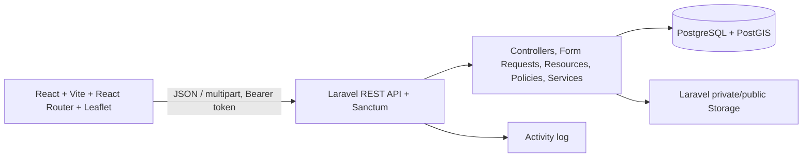
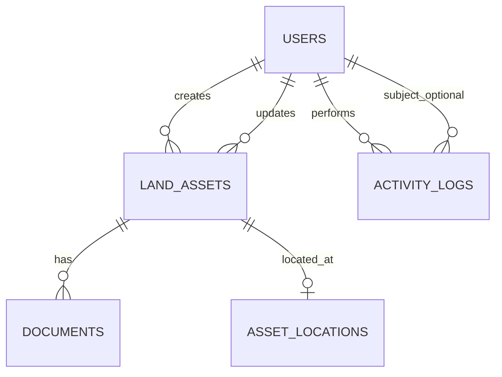

# Arsitektur

Frontend keeps the existing pages and components. `frontend/src/services/api.js` centralizes HTTP, token headers, JSON/multipart bodies, and API errors. Service modules map API resources to the legacy view model where needed. The Vite development proxy forwards `/api` to Laravel on `127.0.0.1:8000`.

## ERD

`activity_logs` uses nullable actor and polymorphic subject identifiers so deletion or logging a system-level action does not erase its history. `system_settings` is a key/value table and must never store credentials or API secrets.

## Data model

| Table | Important columns |
|---|---|
| users | name, username, email, password hash, role, status, last_login_at |
| land_assets | item_name, item_code, register_number, land_area, acquisition_year, location_name, address, district, land_status, ownership_document_type, owner_name, document_date, ownership_document_number, acquisition_origin, asset_value, description, staking_status, bpn_progress, problem_status, problem_detail, google_maps_url, document_archive_reference, created_by, updated_by, deleted_at |
| documents | land_asset_id, document_name/type, generated storage path, original file name, size, MIME, number/date, description, uploader, status, deleted_at |
| asset_locations | land_asset_id, latitude, longitude, `geometry(POINT,4326)`, location_description |
| activity_logs | actor_id, action, subject_type/id, before/after JSON, IP address, created_at |
| system_settings | key, value, type, description |

No row in `asset_locations` means not mapped. A location row requires validated latitude and longitude and creates PostGIS point X=longitude, Y=latitude. Excel Maps links remain reference URLs, never geocoding input.

## Role permissions

| Capability | Admin | Operator | Viewer |
|---|---:|---:|---:|
| Read dashboard, assets, documents, GIS, reports | Yes | Yes | Yes |
| Create/update assets and GIS point | Yes | Yes | No |
| Delete assets or GIS point | Yes | No | No |
| Upload/update documents | Yes | Yes | No |
| Delete documents | Yes | No | No |
| Export reports | Yes | Yes | Optional, default denied |
| Import Excel | Yes | Optional permission, default denied | No |
| User management and settings | Yes | No | No |
| Activity log/security settings | Yes | No | No |

All capabilities are checked by API middleware/policies; hiding UI actions is not an authorization control.

## Migration order

1. Enable PostGIS extension.
2. `users` (including role/status).
3. `land_assets`.
4. `documents`.
5. `asset_locations` with geometry and coordinate checks.
6. `activity_logs`.
7. `system_settings`.

